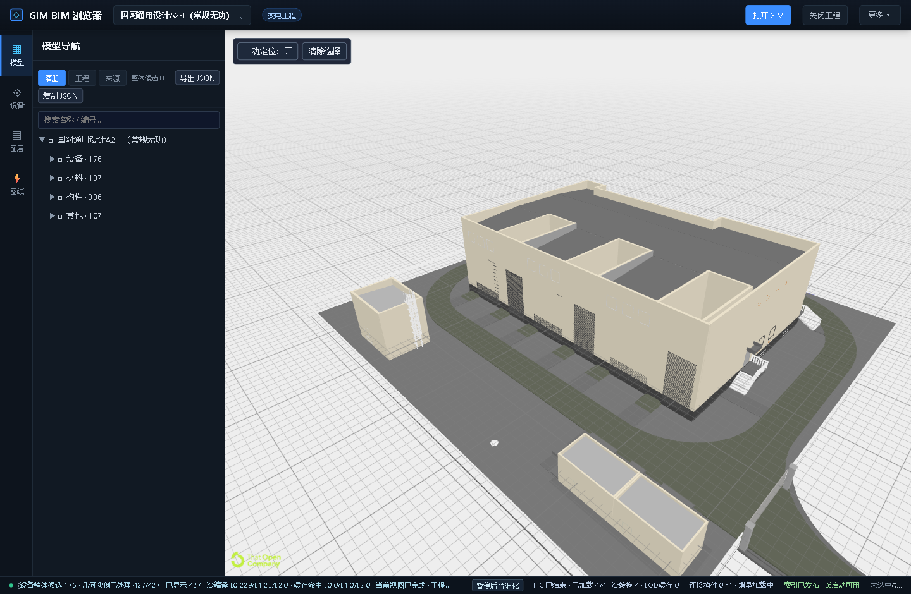
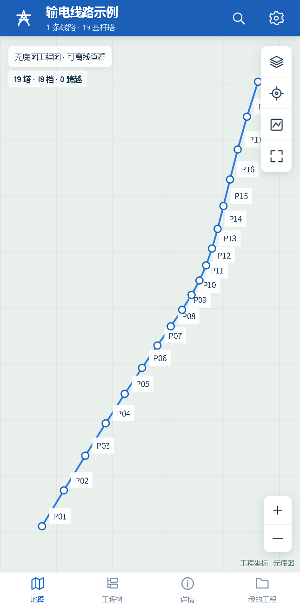

# GIM Viewer

在本地浏览电网工程 GIM 文件。Windows 桌面版支持变电站、输电线路和独立设备，Android 预览版面向输电线路现场查阅。

[下载 Windows 桌面版](https://github.com/bamboosjtu/gim_viewer/releases/tag/desktop-v0.2.1-preview) · [下载 Android 预览版](https://github.com/bamboosjtu/gim_viewer/releases/tag/android-v0.1.6-preview) · [全部发布](https://github.com/bamboosjtu/gim_viewer/releases)

## 界面预览

### Windows 桌面版

*0.2.5 开发版的 Windows 实拍，使用 110 kV 户外变电站通用设计 110-B1-2 方案。左侧清册选中一台油浸式变压器，三维视图同步高亮，右侧显示对象属性。*

桌面三维视口提供对象显隐、楼层过滤、平面与盒式剖切、两点表面距离和标准视角。测量结果显示米制距离与起终点的工程坐标。[桌面端 UI 规范](docs/desktop-ui.md)

### Android 线路版

*移动界面的浏览器预览。示例线路使用虚构数据，截图采用无底图模式。*

手机与折叠屏的界面布局、地图控件和属性面板见[移动端 UI 规范](docs/mobile-ui.md)。

## 下载后开始

| 平台 | 使用方法 |
| --- | --- |
| Windows x64 | 下载后完整解压 Portable ZIP，保留随包的 WebView2 运行时目录，运行 <code>GIM-Reader.exe</code>，打开本地 <code>.gim</code>。 |
| Android ARM64 | 支持 Android 10 及以上。解压发布附件并安装 APK，在应用内通过系统文件选择器导入本地线路 <code>.gim</code>。 |

## 功能

- **变电站与独立设备**　浏览 IFC、DEV/MOD/STL 的三维表示，通过工程树和搜索定位设备，查看分层属性和对应来源。
- **输电线路**　在地图上浏览杆塔、物理档和跨越对象，通过工程树与地图联动查看原始属性和来源。移动端支持现场定位、杆塔局部骨架预览和离线工程图。
- **本地工程管理**　解析、索引和缓存均在本机完成。暖开复用有效的工程缓存。在线底图需要网络，无底图模式可离线查阅工程。

产品行为与已知限制见[桌面规格](docs/software-spec.md)、[移动端规格](docs/mobile-spec.md)和[问题清单](docs/open-issues.md)。

## 性能基线

当前性能对照基线为源码提交 [`f157349`](https://github.com/bamboosjtu/gim_viewer/commit/f157349943e0f1aab7e788d47bbf63f5c5376ce1)，于 2026-11-23 在 Windows x64 固定 WebView2 下完成。每个来源计划一组冷暖配对，时间单位为秒。

| 测量范围 | 记录数 | 结果 |
| --- | ---: | --- |
| L1 线路，6 个工程 | 12 | 12 PASS |
| L1 变电，4 个工程 | 8 | 6 PASS、2 PARTIAL |
| L0 通用设计，48 个输入 | 96 | 78 PASS、8 PARTIAL、5 INPUT_ERROR、5 SKIPPED |

L0 有 5 个输入错误，对应的 5 个暖开未运行。已运行的有效样本没有 FAIL 或 INCONCLUSIVE。更新基线时按同一样本 SHA、场景和冷暖状态核对结果。新增 INPUT_ERROR、FAIL 或 INCONCLUSIVE 属于状态回退，须解决后再更新。

L1 历史正式批准记录对应 [`c50933d`](https://github.com/bamboosjtu/gim_viewer/commit/c50933db56c6442b136705758c1d13ba22810f6f)。原始结果和批准记录保存在开发者本地工作区。[Benchmark 流程](docs/performance/benchmark.md)

### L1 线路

| 启动 | 有效/总数 | 首次响应 | 完全结算 | 完全结算合计 |
| --- | ---: | ---: | ---: | ---: |
| 冷开 | 6/6 | 0.882–4.586 | 5.051–15.373 | 58.002 |
| 暖开 | 6/6 | 0.451–2.364 | 4.022–6.150 | 29.276 |

### L1 变电

| 样本 | 冷开首个可见几何 | 冷开完全结算 | 暖开首个可见几何 | 暖开完全结算 |
| --- | ---: | ---: | ---: | ---: |
| `substation01` | 9.22 | 35.71 | 2.08 | 11.44 |
| `substation02` · PARTIAL | 7.64 | 61.50 | 1.58 | 14.32 |
| `substation03` | 13.67 | 78.38 | 1.54 | 11.18 |
| `substation04` | 6.64 | 30.98 | 1.25 | 9.13 |

`substation02` 的冷暖开均保留来源几何缺口。

### L0 变电通用设计

| 电压等级 | 启动 | 有效/总数 | 首次响应 | 首次几何 | 基础几何齐备 | 完全结算 |
| --- | --- | ---: | ---: | ---: | ---: | ---: |
| 35 kV | 冷开 | 4/4 | 0.634–1.833 | 3.015–5.580 | 9.130–18.261 | 13.280–22.504 |
| 35 kV | 暖开 | 4/4 | 0.288–0.494 | 1.108–1.253 | 2.888–4.592 | 7.114–9.166 |
| 66 kV | 冷开 | 4/6 | 0.676–1.010 | 3.193–3.994 | 9.353–11.706 | 14.020–16.575 |
| 66 kV | 暖开 | 4/6 | 0.277–0.326 | 1.037–1.245 | 3.365–4.875 | 7.087–9.526 |
| 110 kV | 冷开 | 7/10 | 0.914–1.857 | 3.096–6.387 | 8.315–16.809 | 12.676–21.370 |
| 110 kV | 暖开 | 7/10 | 0.309–0.375 | 1.073–1.220 | 1.901–5.068 | 7.074–9.143 |
| 220 kV | 冷开 | 15/15 | 0.607–5.141 | 3.539–20.352 | 5.759–45.487 | 10.269–51.437 |
| 220 kV | 暖开 | 15/15 | 0.278–0.843 | 1.079–2.130 | 1.556–8.944 | 6.071–12.413 |
| 330 kV | 冷开 | 4/4 | 1.116–11.506 | 5.485–21.590 | 9.349–68.045 | 13.379–82.690 |
| 330 kV | 暖开 | 4/4 | 0.327–2.040 | 1.099–3.247 | 2.121–15.659 | 8.157–22.214 |
| 500 kV | 冷开 | 5/5 | 2.825–12.197 | 7.383–28.756 | 27.646–121.075 | 32.967–125.289 |
| 500 kV | 暖开 | 5/5 | 0.554–1.907 | 1.497–3.130 | 3.741–21.153 | 8.113–25.383 |
| 750 kV | 冷开 | 4/4 | 3.132–17.314 | 6.540–32.240 | 27.701–103.518 | 34.718–127.697 |
| 750 kV | 暖开 | 4/4 | 0.672–2.915 | 1.662–4.585 | 6.921–25.556 | 10.410–32.317 |

区间只统计 PASS 和 PARTIAL 的有效观测。5 个损坏输入的冷开记为 INPUT_ERROR，对应暖开记为 SKIPPED。`220-A2-8`、`500-B1-4` 和 `750-B1-2` 在本批次的冷暖开均为 PASS。

#### DEV 与 IFC 分轨

| 电压等级 | 启动 | 有效/总数 | DEV 首绘提交 | DEV 基础结算 | IFC 首绘提交 | IFC 基础结算 |
| --- | --- | ---: | ---: | ---: | ---: | ---: |
| 35 kV | 冷开 | 4/4 | 3.015–5.580 | 3.453–7.891 | 2.942–5.394 | 9.130–18.261 |
| 35 kV | 暖开 | 4/4 | 1.153–1.255 | 1.335–1.611 | 1.086–1.359 | 2.888–4.592 |
| 66 kV | 冷开 | 4/6 | 3.193–3.995 | 5.184–7.311 | 3.115–3.995 | 9.353–11.706 |
| 66 kV | 暖开 | 4/6 | 1.037–1.245 | 1.616–3.132 | 1.106–1.272 | 3.365–4.875 |
| 110 kV | 冷开 | 7/10 | 3.097–6.388 | 6.633–16.508 | 3.410–6.886 | 8.315–16.809 |
| 110 kV | 暖开 | 7/10 | 1.075–2.750 | 1.530–5.068 | 1.150–1.327 | 1.901–5.058 |
| 220 kV | 冷开 | 15/15 | 4.327–20.352 | 3.500–38.735 | 3.543–20.702 | 5.343–45.487 |
| 220 kV | 暖开 | 15/15 | 1.079–2.248 | 1.280–8.944 | 1.139–2.432 | 1.205–5.771 |
| 330 kV | 冷开 | 4/4 | 5.485–21.591 | 8.172–53.279 | 5.678–21.591 | 9.349–68.045 |
| 330 kV | 暖开 | 4/4 | 1.101–3.247 | 1.523–15.263 | 1.249–3.247 | 2.121–15.659 |
| 500 kV | 冷开 | 5/5 | 7.385–28.760 | 17.655–121.075 | 7.179–30.214 | 27.646–95.002 |
| 500 kV | 暖开 | 5/5 | 1.501–3.134 | 3.741–21.153 | 1.435–3.047 | 3.297–12.923 |
| 750 kV | 冷开 | 4/4 | 6.685–32.245 | 24.865–92.769 | 6.467–32.536 | 26.231–103.518 |
| 750 kV | 暖开 | 4/4 | 1.666–4.585 | 5.069–25.556 | 1.539–4.804 | 6.921–23.430 |

## 开发与开源

- [开发指南](docs/development.md) · [架构](docs/architecture.md) · [验证](docs/validation.md) · [GIM 格式](docs/schema/README.md)
- [Windows 桌面应用](desktop/) · [Android 应用](app/) · [独立工具](tools/README.md)

源码采用 [MIT License](LICENSE)。发布包中的 [7-Zip 解码器](desktop/src-tauri/third_party/7zip/License.txt)遵循其第三方许可，源码可从 [7-Zip 官方下载页](https://www.7-zip.org/download.html)取得。在线底图数据归 [OpenStreetMap 贡献者](https://www.openstreetmap.org/copyright)或天地图所有。
