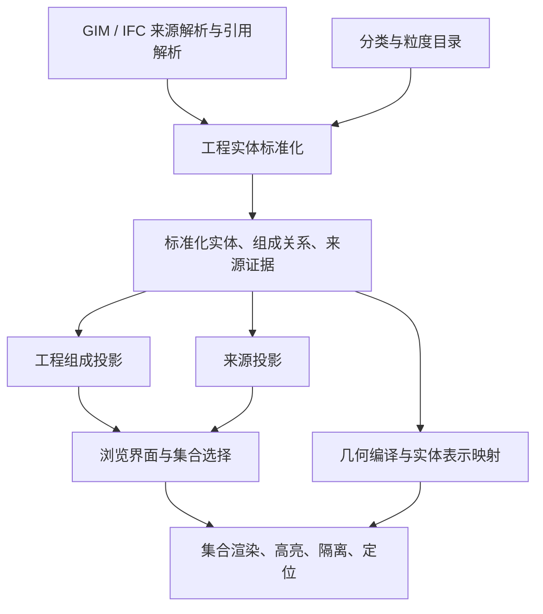

# 系统架构

本文件是架构入口，只保留系统边界、运行时主干和跨主题不变量。具体机制按主题拆分到 `docs/architecture/`，避免单文件承担生命周期、几何、实体、交互和发布的全部细节。

当前桌面版本为 `0.2.0`：变电工程使用“工程组成 / 来源”两个独立投影；工程实体识别与 GIM 文件组织、DEV/IFC 几何表达解耦。桌面变电、线路、独立设备共享容器、打开和缓存基础能力；Android 仍只面向线路。

## 运行时主干

```text
GIM 包
 ├─ 容器与来源引用 ──> 来源图 / 原始记录 ──> 工程整体归一化 ──> 工程组成投影
 │                                      └──> 来源投影（CBM/DEV/IFC 空间）
 ├─ DEV/PHM/MOD/STL ─> SourceGeometryOccurrence ─> RepresentationIndex ─┐
 └─ IFC ─────────────> 空间语义 + bim-lod 表示 ─────────────────────────┴─> 选择 / 高亮 / 隔离 / 相机
```

三条链只通过稳定身份相交：

- 来源链：文件条目、CBM 引用、DEV 实际装配、IFC 外露对象和空间容器；不依赖展示树深度。
- 实体链：包内来源 occurrence → 中立对象证据 → 工程整体/待归集合/成员关系 → 三视图。
- 表示链：真实来源 occurrence → 模板、放置、LOD、IFC 对象；工程整体只绑定来源 ID，不生成新的几何种子。

几何可以先于工程实体完成编译；实体规则变化只重建成员绑定、组成和导航，不强制重新三角化。反过来，实体识别不等待 Viewer、网格、LOD 或 IFC 几何加载。




## 架构文档分工

| 文档 | 负责内容 |
|---|---|
| [分层与依赖](architecture/layers.md) | 目录所有权、依赖边界、入口与平台共享面 |
| [打开与生命周期](architecture/lifecycle.md) | 源身份、解压/解析分支、会话、取消、首开阶段与清理 |
| [缓存域](architecture/caches.md) | SQLite/文件/IndexedDB 域、版本、原子发布与失效 |
| [工程实体运行时](architecture/engineering-runtime.md) | 来源图、实体 Worker、快照、三视图、质量状态 |
| [表示与绑定](architecture/representations.md) | occurrence、工程整体到表示的绑定、反向拾取与歧义 |
| [DEV 几何运行时](architecture/dev-geometry.md) | DEV/PHM/MOD/STL、模板、放置、LOD、Worker 与预算 |
| [IFC 运行时](architecture/ifc-runtime.md) | IFC 发现、空间语义、bim-lod、区域近景、连接构件 |
| [选择与交互](architecture/selection.md) | 选择请求、点击/拖拽、自动定位、高亮、隔离、属性路由 |
| [线路与移动端](architecture/line-mobile.md) | 线路图/地图/缓存、共享 core、Android 边界 |
| [平台与发布](architecture/platform.md) | 安全、配置、诊断、内存压力、打包与验证命令 |

工程实体本身的契约、三视图规则和目录见 [工程实体](engineering/README.md)；GIM 格式与 primitive 见 [Schema](schema/README.md)。

## 跨主题不变量

1. **源身份优先**：源 SHA、大小和 magic 决定工程身份与类型族；缓存不能覆盖源事实，源变化不能继续提交。
2. **实体身份与几何身份分离**：工程整体 ID 由包内来源证据生成，不由 F2/F3/F4、展示名、数组顺序或 Mesh 生成；同一来源的几何 occurrence 另有稳定身份。
3. **成员关系是分区**：每份来源只能有一个主归属（整体、待归集合或仅来源），别名和辅助证据另存，不重复计数；未知与歧义保留。
4. **表示按来源绑定**：DEV/IFC 表示通过来源 ID 绑定到整体；不能按空间邻近、同名或“第一个候选”补造归属。粗表示跨多个整体时保留歧义。
5. **最新选择提交**：选择请求带会话、请求 ID 和取消信号；旧请求的异步属性、高亮、相机和树结果不能覆盖新选择。相机操作与选择相互独立。
6. **缓存域独立失效**：语义、Spatial、DEV 几何、IFC 浏览 LOD、工程来源/实体/导航分别版本化；一个域损坏不删除其他域。
7. **失败局部化**：单文件、单来源、单表示失败不使整个工程消失；空源、不支持、部分表示和运行失败分别记录，不能混成一个“完成”。

## 阅读路径

- 想了解用户可见行为： [桌面软件规格](software-spec.md)。
- 想改工程实体/目录/三视图： [工程实体模型](engineering/README.md) → [目录](engineering/catalogs/README.md) → [工程实体运行时](architecture/engineering-runtime.md)。
- 想改 DEV/XML 几何： [DEV 几何运行时](architecture/dev-geometry.md) → [XML primitive](schema/xml-primitives.md) → [几何模型](schema/geometry-model.md)。
- 想改 IFC/Spatial： [IFC 运行时](architecture/ifc-runtime.md) → [语义模型](schema/semantic-model.md)。
- 想改选择/交互： [选择与交互](architecture/selection.md) → [桌面软件规格](software-spec.md)。
- 想改缓存版本： [缓存域](architecture/caches.md) → [验证](validation.md)。
