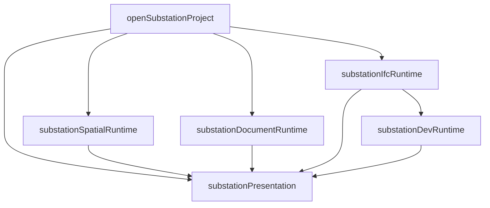

# 运行时与数据库模块

本页说明大型运行时文件内部的职责归属。层间依赖遵循[分层规则](layers.md)，缓存契约和版本以[缓存域](caches.md)为准。

## 稳定入口

| 入口 | 保留职责 | 实现位置 |
|---|---|---|
| `features/substation/application/substationRuntime.ts` | 工程冷/暖打开、核心语义发布、各后台阶段接线 | `features/substation/runtime/*`、`features/substation/presentation/substationPresentation.ts` |
| `features/powerline/application/openPowerlineProject.ts` | 线路冷暖打开与会话视图交接 | `features/powerline/runtime/`、`features/powerline/presentation/` |
| `features/equipment/application/openEquipmentProject.ts` | 独立设备来源准备、导航发布与节点选择 | `features/equipment/runtime/`、`features/equipment/presentation/` |
| `services/geometryOnlyRuntime.ts` | 基于已发布来源树启动纯 DEV 场景、相机与首帧观察 | 独立设备和纯 DEV 变电共同使用 |
| `services/devLodRuntime.ts` | 相机/选择、occurrence、场景提交、坐标锚点和会话关闭 | `devLodTemplateStore.ts`、`devLodArtifactWriter.ts`、`devLodSourceWorkset.ts`、`devLodReadiness.ts` |
| `src-tauri/src/db.rs` | 数据库连接、共享版本和基础查询、命令/DTO 导出 | `src-tauri/src/db/*.rs` |

调用方可以继续从既有入口导入公开函数和类型；内部模块直接引用实际实现和小型契约，不反向依赖入口文件。Tauri 命令名、IPC 数据结构、缓存键和版本不因文件拆分而改变。

## 工程会话与组合根

`app/session/projectSessionState` 管理工程和几何的独立代次、会话作用域、打开意图与 Viewer 清理交接。`ProjectSelectionState` 管理选择请求及释放，Viewer 使用共享窄契约。`app/composition/projectRuntimes` 按来源路由 Feature。`bindProjectShell` 将打开、关闭和最近工程接到对应操作，业务模块通过端口发布展示结果。

组合根为清理注入 Viewer、任务取消和展示端口。共享宿主适配器持有 IFC、MOD/STL、DEV 模板释放与高亮清理。Viewer 仍报告 IFC 模型时，当前清理保留索引并阻止打开，以便重试释放。

## Worker 通信

`infrastructure/workers` 持有工程 Worker 的创建、消息协议、传输编解码与请求释放。`SessionScope` 取消时，客户端解除监听、清除待处理请求及其定时器并终止 Worker。工程服务继续负责同一工程内的构建替换与结果发布。工程、线路与变电 Spatial Worker 复用 `WorkerRequests`，各业务保留自己的计算和回退。

## 工程派生缓存

`infrastructure/cache` 持有工程来源、实体、导航及物理目录的编解码和原生持久化。工程服务确定发布顺序与导航完成状态，Worker 复用同一套编解码，缓存存储按会话与构建检查写入许可。关闭时撤销尚未交给原生端的写入，并按文件顺序交接已进入原生端的写入。

## 原生工程文件

`infrastructure/native` 持有源文件读取、解压文件代理、条目读写和 v1 二进制 envelope。`invokeTimed` 映射原生命令错误并保留原有计时归属。项目 Feature 提供会话守卫，SQLite 索引、线路分块提交与应用设置继续由 bridge 接线。

## 纯 DEV 启动

纯 DEV 启动复用 Viewer 与 DEV LOD 管线。LOD 运行时从创建起就归当前工程会话持有，切换工程时同步释放 Worker、定时器和场景资源。相机命令和坐标锚点按对应的发布实例释放，设备导航由独立设备 Feature 通过端口登记。

## 暖启动核心

缓存校验通过后，`substationWarmCore.publishSubstationWarmCore()` 负责恢复索引、物化工程来源文件并发布 core navigation；`substationRuntime` 只保留工作流协调、冷回退和后台阶段接线。SessionScope 守卫、迟到会话返回和失败释放仍由 Runtime 统一处理。

## 运行时内部职责

| 入口 | 组成阶段 |
|---|---|
| `openProject` | 清理、激活与分派。Native/WASM 获取、同源收据恢复、内容校验由 `projectSourceAcquisition` 负责 |
| `projectCleanup` | 串行交接、状态重置与关闭通知。Viewer 释放由 `ProjectViewerLifecycle` 端口交给宿主适配器 |
| `loadAllIfcFiles` | 引擎与队列启动、队列结算、名称索引与导航尾段 |
| IFC Spatial | 导航记录筛选、CBM 资产关联、覆盖和诊断汇总 |
| `serializeDevToGlbDetailed` | MOD 实例和 STL 实例分别装配，轮廓兜底、GLB 导出与统一释放 |
| `beginEngineeringBuild` | 独立物理目录发布、暖语义缓存恢复、冷构建 |
| 工程 Worker 处理器 | 来源抽取、逐域缓存编码、暖恢复和来源装配分别处理 |
| `buildLineNavigationIndex` | 区段及耐张段投影、未分段对象、跨越关联与索引发布 |
| `buildCbmTree` | 单节点名称和 DEV/FAM 展示数据、来源树递归及装配展开 |
| `renderLineMap` | DOM 和事件生命周期、Canvas 相机和底图视角转发 |
| IFC 浏览 LOD | 模型恢复/转换、派生缓存写入、坐标锚点交接 |
| v1 缓存与原生传输 | 导航清册、待归诊断、组成输入校验；线路 pack 头部与条目校验 |
| Benchmark Host | 工程生命周期、测量流与能力探针 Worker |

各阶段沿用现有会话守卫、调用顺序与读取配额。以生产入口的回归验证拆分后的行为，函数长度只用来定位职责交界。

## 变电生命周期

- `runtime/spatial/substationSpatialWorkflow` 负责暖开恢复或重建的共享启动，以及后台准入。`substationSpatialRuntime` 发布 Spatial 索引，并在来源发布屏障后写缓存。
- `runtime/spatial/substationSpatialWorkerClient` 将专用 Worker 登记到当前 `SessionScope`，由会话失效或任务完成释放。Worker 仍复用共享请求协议和 Spatial 编码器。
- `substationIfcQueue` 负责 IFC 顺序准入、连接预览批次和交接已登记模型。`substationIfcModelLoad` 管理单条目的源读取、进度、会话取消和装载失败清理。`substationIfcRuntime` 接收场景对象，独立处理首个可用模型、首帧观察和后台阶段。
- `substationDevRuntime` 负责 IFC 后的 DEV LOD 启动。
- `substationDocumentRuntime` 负责可选 STD/SLD 的解析与缓存恢复。
- `substationPresentation` 协调导航、选择回调和加载提示，DOM 由 UI 实现。与 IFC 阶段共享的提示标志放在 `substationLoadingState`，IFC 加载开始时重置。
- `substationRuntimeTelemetry` 负责会话守卫下的资源采样和 Spatial parser observer。

这些模块仍属于桌面服务编排层；领域分类留在 `engineering/`，来源适配留在 `gim/engineering/`。

## MOD/STL 与 DEV LOD 的所有权

| 模块 | 负责 | 生命周期约束 |
|---|---|---|
| `modGeometryScene` | 创建并复用 MOD/STL 图层根节点 | 图层随场景释放；放置与范围校验由 DEV LOD 运行时及 Viewer 的几何工具负责 |
| `modGeometrySourceFiles` | 为当前会话建立共享的设备来源文件索引 | 读请求沿真实引用链触发；会话失效后拒绝读取 |
| `nodeInteractionService` / `nodeGeometrySelection` | 协调节点选择、属性、导航、高亮和相机 | 选择请求可以失效，已开始的同工程几何任务仍可供后续选择复用 |
| `nodeGeometryLoader` / `nodeDevGlbLoader` | 去重加载同一 occurrence，提交原始 MOD/STL 或缓存 GLB | 发布前检查工程会话，落后结果释放资源 |
| `nodeGeometrySources` / `ifcGeometrySource` | 按来源引用读取当前文件和缓存条目 | 共享 IFC 来源读取，原生批次的借用字节在构建独立 File 后释放 |
| `devLodTemplateStore` | 请求去重、缓存输入预算、模板校验/编译、L1 demand 和 LRU | 与一个工程会话绑定；取消时关闭 reader、拒绝排队请求；移除场景使用者后释放模板 |
| `devLodArtifactWriter` | 缓存准备、写入准入、并发槽和写入诊断 | 取消未准入写入；已开始的原生写入继续持有预算，完成后释放 |
| `devLodSourceWorkset` | 有界预取、部分缓存缺失后的来源恢复 | 使用当前会话及压力回调；不抢占几何计算槽 |
| `devLodReadiness` | occurrence 状态增量计数和可选审计 | 无 IO、场景创建或 DOM 依赖 |
| `devLodDiagnostics` / `devLodTypes` | 诊断形状和内部共享类型 | 诊断实例由会话共享；类型模块只使用类型导入 |

`DevLodRuntime` 组合这些组件，向它们提供会话有效性、Worker、来源准备、诊断发布和就绪刷新回调。组件不接收整个运行时实例，也不通过类型断言访问其私有状态。普通选择、自动 LOD 和显式 L2 的策略仍由运行时协调。

Viewer 的初始化只加载 `selectionNavigation`。节点选择在用户操作时接入几何加载，源读取与 Viewer 提交分别持有会话检查。

## 原生持久化

| 模块 | 职责 |
|---|---|
| `db/schema.rs` | 建表与迁移 |
| `db/projects.rs` | 源身份登记、项目记录和 SHA 守卫 |
| `db/substation_index.rs` | 变电索引、属性、几何引用及语义补写事务 |
| `db/line_index.rs` | 线路图与属性的分块事务和查询 |
| `db/cache_paths.rs` | 路径约束、reparse point 检查、staging 与目录所有权 |
| `db/cache_protocol.rs` | 二进制 IPC envelope、批量结果编码与传输配额 |
| `db/cache_transport.rs` | 受权的源缓存读写命令 |
| `db/semantic_pack.rs` | 线路/变电来源包、索引和有界读取 |
| `db/geometry_cache.rs` | DEV GLB/LOD 文件、manifest 和发布标记 |
| `db/cache_validation.rs` | 分域缓存有效性及来源/属性完整性检查 |
| `db/diagnostics.rs` | 只读缓存诊断 |
| `db/project_cache.rs` | 设置、最近工程、打开受权和缓存删除 |
| `db/validation_profile.rs` | 调用级校验计时 |

实现模块按具体依赖导入相邻模块；文件安全、二进制协议和数据库事务分别维护。内部辅助函数只在 `db` 范围可见，`db.rs` 导出公开命令与 DTO，`lib.rs` 集中注册 Tauri 命令。

数据库测试位于 `db/tests.rs`；真实 SQLite 交换入口继续使用 `db::substation_sqlite_tests::substation_sqlite_exchange`。

## 验证入口

- `npm test`：工程打开、LOD、缓存预算、取消、选择和几何等快速测试。
- `npm run test:sqlite`：生产 Rust 保存/查询路径的真实 SQLite 往返。
- `cargo test --lib --manifest-path src-tauri/Cargo.toml`：原生路径安全、语义包、缓存协议及事务测试；临时文件应使用可写的隔离目录。
- `npm run check:engineering-boundaries`：层间依赖、运行时组件反向依赖入口与模块内循环检查。
- `npm run build` 与 `cargo check --manifest-path src-tauri/Cargo.toml`：前端生产分包、类型检查和 Tauri 命令注册兼容性。

## 相关文档

- [分层与依赖](layers.md)
- [缓存域](caches.md)
- [打开与生命周期](lifecycle.md)
- [DEV 几何运行时](dev-geometry.md)
- [平台、安全与发布](platform.md)
