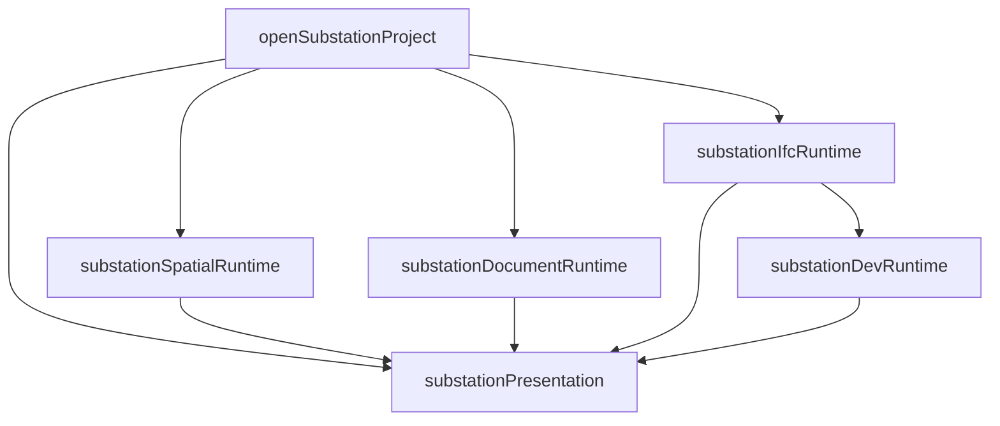

# 运行时与数据库模块

本页说明大型运行时文件内部的职责归属。层间依赖遵循[分层规则](layers.md)，缓存契约和版本以[缓存域](caches.md)为准。

## 稳定入口

| 入口 | 保留职责 | 实现位置 |
|---|---|---|
| `services/substationRuntime.ts` | 工程冷/暖打开、核心语义发布、各后台阶段接线 | `substation*Runtime.ts`、`substationPresentation.ts` |
| `services/modAutoLoadService.ts` | MOD/STL 加载决策、进度与整体回退编排 | `devGlbCacheFastPath.ts`、`devGlbCacheRecovery.ts`、`modRawGeometryLoader.ts`、`modGeometry*` |
| `services/devLodRuntime.ts` | 相机/选择、occurrence、场景提交、坐标锚点和会话关闭 | `devLodTemplateStore.ts`、`devLodArtifactWriter.ts`、`devLodSourceWorkset.ts`、`devLodReadiness.ts` |
| `src-tauri/src/db.rs` | 数据库连接、共享版本和基础查询、命令/DTO 兼容导出 | `src-tauri/src/db/*.rs` |

调用方可以继续从既有入口导入公开函数和类型；内部模块直接引用实际实现和小型契约，不反向依赖入口文件。Tauri 命令名、IPC 数据结构、缓存键和版本不因文件拆分而改变。

## 变电生命周期

- `substationSpatialRuntime` 负责 Spatial 恢复、重建、缓存发布与后台门控，保留捕获的工程会话检查。
- `substationIfcRuntime` 负责 IFC 顺序队列、首个可用表示、区域批次、缓存读取和加载诊断。
- `substationDevRuntime` 负责 IFC 后的 DEV LOD 启动与既有几何恢复路径。
- `substationDocumentRuntime` 负责可选 STD/SLD 的解析与缓存恢复。
- `substationPresentation` 负责导航 DOM、选择回调和加载提示。与 IFC 阶段共享的提示标志放在 `substationLoadingState`，IFC 加载开始时重置。
- `substationRuntimeTelemetry` 负责会话守卫下的资源采样和 Spatial parser observer。

这些模块仍属于桌面服务编排层；领域分类留在 `engineering/`，来源适配留在 `gim/engineering/`。

## MOD/STL 与 DEV LOD 的所有权

| 模块 | 负责 | 生命周期约束 |
|---|---|---|
| `devGlbCacheFastPath` | 有界 GLB 批量读取、完整性检查、模板池和 occurrence 放置 | 只提交当前几何上下文；失败按 DEV 返回 |
| `devGlbCacheRecovery` | 对失败的 DEV 重编并修复缓存 | 保留已经成功的模板及表示 |
| `modRawGeometryLoader` | 指定 DEV occurrence 的原始 MOD/STL 回退 | 保留逐边矩阵、来源身份和取消检查 |
| `modGeometryScene` | 图层根节点、范围检查和场景放置 | 由服务层持有图层；遵守 Viewer 的资源释放契约 |
| `modGeometrySourceFiles` | 来源文件水合及单个 MOD/STL 加载 | 仅沿真实引用链读取 |
| `modGeometryContracts` | 加载选项、进度和捕获上下文检查 | 不创建几何或决定实体分类 |
| `devLodTemplateStore` | 请求去重、缓存输入预算、模板校验/编译、L1 demand 和 LRU | 与一个工程会话绑定；取消时关闭 reader、拒绝排队请求；移除场景使用者后释放模板 |
| `devLodArtifactWriter` | 缓存准备、写入准入、并发槽和写入诊断 | 取消未准入写入；已开始的原生写入继续持有预算，完成后释放 |
| `devLodSourceWorkset` | 有界预取、部分缓存缺失后的来源恢复 | 使用当前会话及压力回调；不抢占几何计算槽 |
| `devLodReadiness` | occurrence 状态增量计数和可选审计 | 无 IO、场景创建或 DOM 依赖 |
| `devLodDiagnostics` / `devLodTypes` | 诊断形状和内部共享类型 | 诊断实例由会话共享；类型模块只使用类型导入 |

`DevLodRuntime` 组合这些组件，向它们提供会话有效性、Worker、来源准备、诊断发布和就绪刷新回调。组件不接收整个运行时实例，也不通过类型断言访问其私有状态。普通选择、自动 LOD 和显式 L2 的策略仍由运行时协调。

## 原生持久化

| 模块 | 职责 |
|---|---|
| `db/schema.rs` | 建表与迁移 |
| `db/projects.rs` | 源身份登记、项目记录和 SHA 守卫 |
| `db/substation_index.rs` | 变电索引、属性、几何引用及语义补写事务 |
| `db/line_index.rs` | 线路图与属性的分块事务和查询 |
| `db/cache_paths.rs` | 路径约束、reparse point 检查、staging 与目录所有权 |
| `db/cache_protocol.rs` | 二进制 IPC envelope、批量结果编码与传输配额 |
| `db/cache_transport.rs` | 受权的源缓存读写命令 |
| `db/semantic_pack.rs` | 线路/变电来源包、索引和有界读取 |
| `db/geometry_cache.rs` | DEV GLB/LOD 文件、manifest 和发布标记 |
| `db/fragments_cache.rs` | Fragments 文件、记录和有效性 |
| `db/cache_validation.rs` | 分域缓存有效性及来源/属性完整性检查 |
| `db/diagnostics.rs` | 只读缓存诊断 |
| `db/project_cache.rs` | 设置、最近工程、打开受权和缓存删除 |
| `db/validation_profile.rs` | 调用级校验计时 |

实现模块按具体依赖导入相邻模块；文件安全、二进制协议和数据库事务分别维护。内部辅助函数只在 `db` 范围可见，`db.rs` 保留既有公开命令与 DTO，`lib.rs` 继续集中注册 Tauri 命令。

数据库测试位于 `db/tests.rs`；真实 SQLite 交换入口继续使用 `db::substation_sqlite_tests::substation_sqlite_exchange`。

## 验证入口

- `npm test`：工程打开、LOD、缓存预算、取消、选择和几何等快速测试。
- `npm run test:sqlite`：生产 Rust 保存/查询路径的真实 SQLite 往返。
- `cargo test --lib --manifest-path src-tauri/Cargo.toml`：原生路径安全、语义包、缓存协议及事务测试；临时文件应使用可写的隔离目录。
- `npm run check:engineering-boundaries`：层间依赖、运行时组件反向依赖入口与模块内循环检查。
- `npm run build` 与 `cargo check --manifest-path src-tauri/Cargo.toml`：前端生产分包、类型检查和 Tauri 命令注册兼容性。

## 相关文档

- [分层与依赖](layers.md)
- [缓存域](caches.md)
- [打开与生命周期](lifecycle.md)
- [DEV 几何运行时](dev-geometry.md)
- [平台、安全与发布](platform.md)
