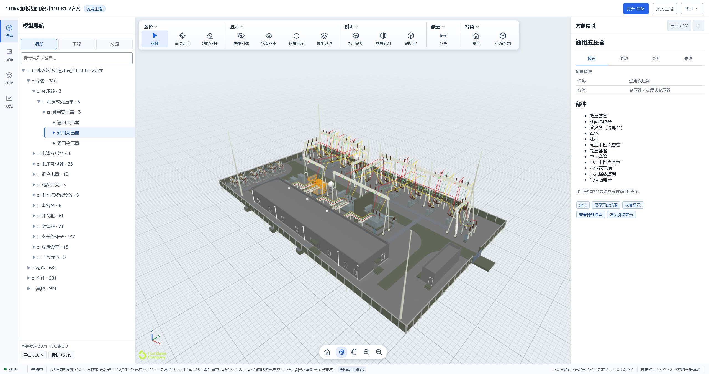

# 桌面端 UI 规范

本页维护 Windows「GIM 阅读器」的界面结构、控件样式和调整后的复核项目。工程格式、加载流程和业务操作的含义见[桌面软件规格](software-spec.md)，Android 界面另见[移动端 UI 规范](mobile-ui.md)。

## 目录

- [工作台结构](#工作台结构)
- [工程模式](#工程模式)
- [导航、选择与属性](#导航选择与属性)
- [视觉样式与反馈](#视觉样式与反馈)
- [窗口与界面复核](#窗口与界面复核)

## 工作台结构

| 区域 | 当前界面 |
|---|---|
| Windows 原生标题栏 | 显示「GIM 阅读器」，使用应用图标。 |
| 工程栏 | 左侧显示当前工程名和类型标签，长名称单行省略，悬停可查看全名。右侧固定「打开 GIM」「关闭工程」「更多」。 |
| 左侧 | 工作区轨配图标和文字。导航面板承载当前工程的导航树、搜索和该模式可用的命令。 |
| 中央 | 变电站或设备的三维视口，或线路工程地图。视口使用两侧面板之外的空间，随窗口连续调整。 |
| 右侧 | 「对象属性」默认收起。收起后释放宽度，在视口右上显示「展开对象属性」。展开与收起复用当前属性内容和页签，手动操作后焦点回到对应控件。 |
| 底部 | 状态栏在主区之外占 30 CSS px，分区显示工程状态、当前选择、加载进度和模式统计。 |

空工程的欢迎区提供「打开 GIM」「继续上次工程」和最近工程。附加 IFC、缓存管理和设置从「更多」访问，视角历史和隔离命令随会话能力显示。完整菜单及恢复行为见[顶栏与更多菜单](software-spec.md#顶栏与更多菜单)。界面骨架和窗口样式以[桌面 HTML](../desktop/index.html)与[工作台样式](../desktop/src/ui/app.css)为准。

## 工程模式

| 类型标签 | 左侧入口与查找 | 中央视图 |
|---|---|---|
| 变电工程 | 工作区轨显示「模型」「设备」「图层」「图纸」。模型导航默认「清册」，可切换「工程」「来源」。导航底部显示整体候选、待归集合和当前树的「导出 JSON」「复制 JSON」。 | 站区三维模型。「图纸」对应的单线图可在视口内叠加，三维场景继续保留。 |
| 线路工程 | 工作区轨保留「模型」。线路导航按业务层级浏览线路、区段、耐张段、杆塔等对象。 | 二维工程地图，提供「全景」、图层勾选和底图选项。 |
| 设备模型 | 工作区轨保留「模型」。导航显示设备根和子装配，搜索范围取当前装配节点。 | 独立设备三维视图，可从树或属性定位带有可用表示的装配，按当前节点能力显示精细模型操作。 |

从变电的设备、图层或图纸切到线路或独立设备时，宿主切回「模型」。返回变电工程后恢复四个入口。工作区切换规则和三视图职责分别见[工作区切换实现](../desktop/src/ui/tabs.ts)与[工程组成、来源与设备材料清册](engineering/composition.md)。

## 导航、选择与属性

- 共用搜索框高 35 CSS px，以名称或编号查找当前模式索引中的对象。变电虚拟树使用 30 px 行高、每级 15 px 缩进。选择揭示树行时只滚动导航面板，工程栏、视口及状态栏留在各自的布局区域。
- 「选择」组的「自动定位」作用于树与搜索选择。选择模式下三维单击选中对象，拖动控制相机。「清除选择」退出当前选择隔离，并保留工具箱里的临时隐藏与过滤。
- 选中树行使用浅蓝背景和蓝色边线。三维主体保留材质，选中用琥珀色轮廓，悬停用半透明轮廓。线路地图和导航树按同一线路对象联动。调整布局后，拾取使用当前画布与地图范围。
- 对象属性包含「概览」「参数」「关系」「来源」四个页签，显示当前实体、分组或来源所具备的字段。可从「来源」查阅指向原始数据的证据。歧义关系保留候选，缺失、未读取和局部几何失败各自显示对应状态。
- 变电和设备的常规选择遵循「选择对象时展开属性」设置。线路的对象选择会打开检查器。「导出 CSV」汇集检查器各页签中已渲染的表格属性，切换当前页签不会缩小导出范围。

选择与可见性行为见[选择与交互](architecture/selection.md)。实现落点见[虚拟树](../desktop/src/ui/virtualOutline.ts)、[对象属性](../desktop/src/ui/propsDrawer.ts)、[线路视图](../desktop/src/ui/lineProjectView.ts)。

### 三维视口工具

| 入口 | 使用方式 |
|---|---|
| 显示 | 可连续隐藏对象、仅看当前选择或恢复工具箱范围。模型与 IFC 类型在展开项中调整。楼层按模型区分，默认使用明确关联，可勾选「包含空间推断」。 |
| 剖切 | 选水平面、垂直面或工程轴向剖切盒。位置以工程米输入，也可拖动场景手柄。平面可翻转，范围可暂时停用或清除。切回选择后继续按剖切范围浏览。 |
| 测量 | 顺序点击两个可见表面。线段、端点和读数在视口显示，右侧用大字号显示距离（m），下方三行分别列出 X、Y、Z，在起点和终点两列比较数值。打开右栏时结果占用右栏内容区，收起时位于视口右侧。可连续添加、逐条删除或清空。Esc 优先取消正在拾取的起点。 |
| 视角 | 可复位到全景、切换俯视／正视／右视／轴测，已有视角历史时可返回。底部相机控件提供复位、旋转、平移、放大和缩小。 |

选择、显示、剖切、测量、视角分组横向排列。宽视口显示图标与短标签，窄视口保留图标和组名，悬停或键盘聚焦时提供中文提示。左下角 XYZ 轴随相机方位更新，表示当前可用的工程或场景坐标方向。展开长树时只滚动树列表，视图切换、搜索和底部 JSON 操作保留在各自区域。

几何测距使用当前可见模型表面，距离与坐标以米保留三位小数。实际精度取决于显示模型的几何细节。图层开关独立于临时隐藏、隔离与楼层过滤。线路地图沿用全景、图层和底图控件。

## 视觉样式与反馈

| 项目 | 当前值或用法 |
|---|---|
| 底色 | 工作台 `#F2F5F8`，主面板白色，次级面 `#F7F9FC`，悬停面 `#EEF3F8`，边界 `#D8E0E8`。三维视口底色为 `#E9EEF3`。 |
| 文字 | Microsoft YaHei UI、Segoe UI、Noto Sans SC、sans-serif。正文 `#1F2937`，次级文字 `#475467`，辅助及技术值 `#667085`。需要等宽的技术内容采用 Cascadia Mono、JetBrains Mono、Consolas、monospace。 |
| 操作与焦点 | 主蓝 `#2563EB`，浅蓝选中底 `#EAF2FF`。基础键盘焦点轮廓 2 px。对象标题用深色，活动页签用主蓝与下边线。 |
| 工程反馈 | 完成 `#15803D`，警告 `#B45309`，错误 `#B91C1C`。三维选中用 `#F59E0B`，与工作区导航的蓝色分开。 |

状态栏用文字配合状态点表达加载、就绪和失败。视图开始可用后，IFC、DEV、连接构件与索引发布的后续进度留在状态栏，并保留当前选择及已有的暂停／继续后台细化入口。计数沿用各自口径，设备整体候选、几何实例、IFC 文件分别显示。长工程名与树行允许省略，属性值中的长路径与技术字段允许在内容区换行。普通正文保持可读，依靠边界辨认的控件应保有清晰轮廓，关键状态同时用文字表达。系统开启减少动态效果时，样式缩短动画与过渡。

## 窗口与界面复核

首次启动时原生窗口最大化到当前工作区。退出时记录最后有效普通窗口的逻辑尺寸、相对显示器工作区的位置与最大化状态；再次启动先恢复再显示，显示器变更时将窗口限制在可用工作区。最小窗口为 1200×700。布局按 WebView 客户区的 CSS 像素计算。工程栏高 50 px，以下宽度取[实际样式](../desktop/src/ui/app.css)中的断点值。

| 客户区宽度（CSS px） | 工作区轨 | 左侧导航 | 展开的对象属性 |
|---|---:|---:|---:|
| 小于 1360 | 48 | 240 | 300 |
| 1360–1439 | 48 | 260 | 300 |
| 1440–1599 | 48 | 280 | 320 |
| 1600–1999 | 52 | 312 | 360 |
| 2000 及以上 | 52 | 340 | 400 |

- 原生复核使用 1920×1080、2560×1440 两种物理分辨率，各测 Windows 100% 和 125% 缩放。记录客户区宽高和 `devicePixelRatio`，并检查初始、最小窗口。
- 分别打开三种模式，收放对象属性后点击三维构件或地图塔位，核对树、视图高亮和属性指向同一对象。变电树深层定位后，确认只有导航面板滚动，顶部工程栏和底部状态栏完整可见。
- 在紧凑窗口核对长工程名、搜索与命令可达性、对象属性长值换行和错误状态的可读性。截图与真实运行证据按[真实桌面复核](validation.md#真实桌面复核)留存。
