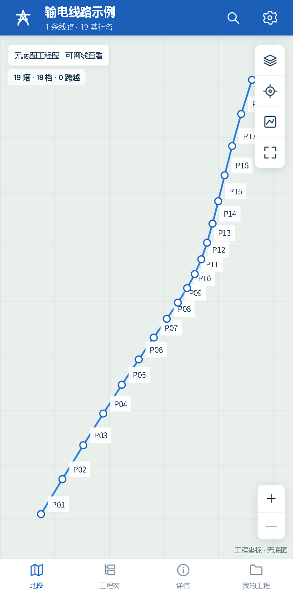

# 移动端 UI 规范

本页维护 Android「线路 GIM」的地图工作区、响应式面板、触控交互和界面反馈。导入、存储、网络与设备验收见[移动端规格](mobile-spec.md)，Windows 界面另见[桌面端 UI 规范](desktop-ui.md)。

*上图为使用虚构数据的浏览器预览。*

## 目录

- [地图工作区](#地图工作区)
- [响应式布局与安全区](#响应式布局与安全区)
- [工程树与对象详情](#工程树与对象详情)
- [沉浸地图与反馈](#沉浸地图与反馈)
- [视觉样式与界面复核](#视觉样式与界面复核)

## 地图工作区

| 区域 | 当前界面 |
|---|---|
| 顶栏 | 左侧塔形按钮打开「我的工程」，中间显示工程名和摘要，右侧提供搜索与「地图设置」。长工程名省略。搜索打开工程树并将焦点放在搜索框。 |
| 地图 | 显示杆塔、档和跨越物。左上显示当前底图与工程摘要，右侧提供底图设置、当前位置、全工程范围、沉浸地图及放大／缩小。保持地图署名可见。 |
| 底部导航 | 「地图」「工程树」「详情」「我的工程」。工程树和详情可分别收放。「地图」同时收起两者，释放地图空间。 |
| 欢迎与工程管理 | 欢迎页提供「导入线路工程」和「查看我的工程」。工程列表显示杆塔数、档数、文件大小和导入日期，点击列表项打开；删除需通过确认弹窗。 |

「底图」设置包括天地图影像、矢量、地形，以及 OpenStreetMap 和「无底图工程图」。在受控回退中，工程覆盖层独立于在线底图继续显示，已选对象与相机保持。切换底图与定位的条件见[移动端规格](mobile-spec.md)。界面入口见[移动端界面实现](../app/src/main.ts)。

## 响应式布局与安全区

地图填满剩余空间。首次打开工程时，树与详情默认收起。重新打开同一工程时恢复各自的保存状态，只有展开的侧栏占用对应列宽。以下尺寸用 CSS px 表示。

| WebView 客户区条件 | 工程树展开时 | 详情打开时 |
|---|---|---|
| 宽度小于 600 | 左侧覆盖式面板，右边留 48 px | 地图下方 286 px 详情区，可通过顶部手柄展开 |
| 宽度 600–839 | 左栏宽 230 px | 地图下方 310 px 详情区，可通过顶部手柄展开 |
| 宽度 840–1199 | 左栏宽 280 px | 地图下方 310 px 详情区，可通过顶部手柄展开 |
| 宽度至少 1200 | 左栏宽 280 px | 右栏宽 340 px |
| 宽度至少 600，且高度不超过 500 | 矮屏布局优先，左栏宽 190 px | 右栏宽 260 px |

- 顶栏内容区高 52 px。底部导航内容区在窄屏高 52 px，从 600 px 宽起为 48 px，分别加上对应系统安全区。地图宿主高度低于 340 CSS px 时，隐藏左上地图摘要，右下缩放按钮横排。
- Android 原生窗口在最小屏宽小于 600 dp 时锁定竖屏，达到该阈值后交由系统决定方向。该规则使用 Android dp；上表使用 WebView CSS px。
- 原生窗口 Insets 转为 CSS 像素后交给顶栏、底栏、浮动按钮与弹窗避让系统栏及开孔。折叠、展开和允许的旋转应保留当前工程、相机、选择、树展开和详情页签。

样式与短地图判断见[移动端样式](../app/src/style.css)及[地图工作区实现](../app/src/map/workspace.ts)，方向策略见[原生窗口状态](../crates/tauri-plugin-gim-import/android/src/main/java/com/gimviewer/importer/MobileWindowState.kt)。

## 工程树与对象详情

- 「工程导航」提供「结构」「对象」两种视图，包含分类筛选、塔号／塔型／耐张段等搜索。结构视图反映所属路径，对象视图按业务对象浏览。树使用 48 CSS px 固定行高的虚拟列表，选中后揭示对应行。
- 树和地图共用当前对象。常规视图选中对象后打开详情，宽度小于 600 CSS px 时同时收起树。详情标题显示对象类型和名称，可定位当前对象或关闭面板。
- 详情页签为「概览」「属性」「关系」「来源」。「概览」以标签和数值展示杆塔、档、跨越物等对象的摘要。「属性」保留原键和来源信息。「关系」提供可访问的关联对象。「来源」按展开的条目读取单个文件。
- 有可用 HNum 数据的杆塔在概览中展示二维骨架，支持拖动、缩放和重置。来源无数据或读取失败时在预览区显示对应反馈。按工程保存面板、展开和页签状态，收起详情后可以从原选择继续查看。

树实现见[虚拟树](../app/src/ui/virtual-tree.ts)，字段和杆塔预览边界见[移动端规格](mobile-spec.md#数据与缓存契约)。

## 沉浸地图与反馈

- 工程打开后，地图工具栏可进入沉浸。地图铺满窗口，工程树、详情、底栏和系统栏暂时隐藏，原有选择、相机和面板偏好保留。可从屏幕边缘滑动暂时唤回系统栏。返回键、打开普通弹窗或离开前台均退出沉浸。重新打开工程时从普通视图恢复。
- 在沉浸地图选中对象，左下显示可关闭的概览卡。卡片共用常规概览字段，宽度小于 600 CSS px 时单列布局，达到 600 px 时双列。点击「查看详情」恢复普通视图，并打开当前对象的概览。仅显示概览卡时无需加载杆塔骨架。
- 导入进度、失败和取消在导入流程中反馈。底图、定位等操作的消息通过状态提示显示。点击「当前位置」后先显示定位说明，随后按 Android 前台权限读取一次位置；可用时展示位置精度、时间及到目标塔的水平直线距离。
- 系统返回优先取消导入或关闭弹窗，然后退出沉浸、收起工程树、收起展开的详情或关闭详情，最后交回系统处理。

## 视觉样式与界面复核

界面以深蓝色文字 `#19334C`、蓝色顶栏 `#1B5FB9`、白色面板和浅色地图控件组成。主要按钮与活动页签使用 `#1768C8`，选中树行使用 `#E5F1FF` 底色和蓝色左边线。正文基准字号 14 CSS px，工程栏标题 17 px。支持 Inter、Segoe UI、PingFang SC、Microsoft YaHei 和 sans-serif 字体回退。顶栏图标按钮的触控区至少 44×44 CSS px。图标操作提供可访问名称，主导航使用图标与文字，保留可见焦点与禁用态。

修改界面后，按[移动端验证](validation.md#移动端验证)复核手机竖屏、折叠外屏／展开屏、可旋转大屏和矮横屏。检查安全区、地图按钮与选中命中，逐项核对树、详情与沉浸切换后的窗口内可达性，以及折叠前后的工程和选择恢复。原生权限、系统返回和方向策略在 Android 真机或模拟器中验证，浏览器预览用于核对 WebView 布局与交互。
